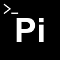

# Card Pi



Card Pi 是面向 CardputerZero（ARM64）的第三方 Pi 客户端。它在设备本机直接调用原版 [Pi](https://pi.dev/)，并把对话、项目和会话操作适配到 320×170 屏幕与实体键盘。

Card Pi 和终端 Pi 在同一设备账号下共用 Pi 的模型登录、配置、项目扩展和会话。配置方法沿用 [Pi 官方文档](https://docs.pi.dev/latest/configuration)。你可以继续在设备终端、ZeroDesk Shell 或 SSH 中直接运行 Pi，也可以用 Card Pi 打开同一项目下的已有会话。

## 功能

- **小屏对话**。流式显示 Pi 回复。输入框可用 `↑/↓` 回找已发送的输入。按 `Fn+L`（外接键盘的 `Page Up`）或从会话菜单进入全屏历史。用方向键或 `F/X` 移动，长按连续滚动，`Fn+L/M` 整页翻动。
- **直接操作 Pi**。菜单提供模型切换、常规设置、思考强度、模型轮换范围和服务商登录。按 `/` 也能打开原生命令菜单。
- **项目和会话管理**。浏览文件夹或输入路径启动 Pi，设置默认项目，继续最近项目。会话支持新建、恢复、改名，以及移入回收站后恢复或永久删除。
- **Rime（中州韵）离线拼音**。支持全拼、自然码双拼、简繁切换、中英文标点和候选翻页。界面可独立切换简体中文和 English。
- **检测和安装 Pi**。启动时复用可用的 Pi，缺失时提供安装按钮，从官方渠道下载到当前用户的目录。

## 安装

将 ARM64 的 `.deb` 复制到 CardputerZero，在包所在目录执行以下命令。已有旧版可用同一条命令升级。

```sh
sudo apt install ./card-pi_0.1.0~beta18_arm64.deb
```

设备已有兼容的 Node.js 和 npm 时，Card Pi 调用 Pi 官方 Linux 安装器。缺少兼容运行时的设备使用经过 SHA-256 校验的 Pi 1.6.0 官方 ARM64 独立包，下载约 56 MiB，安装到 `~/.local/share/card-pi/pi-1.6.0/`。可从「设置 → Pi 设置 → Pi 核心信息」查看实际可执行文件路径，并在终端直接使用该路径。 [Pi 官方安装指南](https://docs.pi.dev/latest/quickstart) · [Pi 1.6.0 发布包](https://github.com/earendil-works/pi/releases/tag/v1.6.0)

从源码构建时，在项目根目录运行 `python3 packaging/build_deb.py`。安装包会生成在 `dist/`。

## 快速开始

1. 在设备 HOME 打开 **Card Pi**。如果没有检测到 Pi，按 **6 安装**，或按 **7 指定 Pi** 选择已有可执行文件。
2. 首次配置模型时，进入「设置 → Pi 设置 → 登录服务商」，按 Pi 的提示完成登录，再按 **Ctrl+Q** 返回。已有 Pi 登录可直接使用。
3. 选择项目目录，然后新建或恢复会话。在项目目录页可按 **7** 输入绝对路径。
4. 在对话中按 **Ctrl+Space** 切换中英文。输入 `nihao` 后按 **Space** 或 **1–5** 选字，再按 **OK** 发送。候选栏打开时可用 **Fn+F/X** 或 **Fn+L/M** 翻页。
5. 按 **Tab** 打开会话菜单。各级菜单可长按 **↑/↓** 或 **F/X** 连续移动，松键即停。全屏历史中按 **Esc** 返回对话，任意页面长按 **Esc** 返回 HOME。

首页左侧显示 Pi 核心版本，右上角每 8 秒在 Card Pi 版本与本机日期、时间和电量之间切换。聊天底栏轮播操作提示、缓存读写、上下文用量、输入输出 Token 和费用。首页的「升级 Pi」会执行当前 Pi 的 `pi update` 并实时显示终端输出，运行结束后按 **Esc** 返回。Pi 自行决定当前安装方式是否支持自更新。直接解压的独立二进制由 Pi 在终端给出手动更新提示。 [Pi 更新命令](https://docs.pi.dev/latest/cli#update-pi-or-packages)

## 设置

- **Pi 设置**。从首页「设置 → Pi 设置」或对话的 **Tab → Pi 设置** 打开。进入 Pi 原生页面后按 **Ctrl+Q** 返回菜单，Pi 自行保存原生设置。
- **显示设置**。从首页「设置 → 显示设置」或对话「Tab → 显示设置」进入。Markdown 默认开启，支持标题、强调、列表、引用、链接文字、代码和简化表格。关闭后按原文显示。聊天字号可选 11、13、15 px，行距可选紧凑或宽松，适用于对话和全屏历史。终端字号可选 8、9、11 px，适用于 Pi 原生命令和升级日志。
- **输入法设置 · Rime 中州韵**。聊天、会话重命名、目录路径、Pi 可执行文件路径和扩展文本框都可按 **Ctrl+Space** 切换中英文。输入拼音后按 **Space**、数字键或 **OK** 选字，候选确认后再按 **OK** 提交。可选简繁、全拼或双拼、候选数、中英文标点、字符宽度、模糊音、补全、整句候选和词频学习。恢复默认会保留已经学习的词库。首次使用某个方案时，设备可能需要短暂构建词库。
- **会话管理**。从首页「会话管理」选择项目。在会话列表选中会话，按 **7** 改名，按 **8** 确认移入回收站。进入「会话回收站」，选中记录后按 **OK** 恢复，或按 **8** 打开永久删除确认页。永久删除后无法恢复。

## 商店资料

[app-builder.json](app-builder.json) 提供简体中文、英语和日语的商店标题、短简介和长介绍，分享码为 **MPIC**。应用界面支持简体中文和英语。

[商店图标](packaging/card-pi-store.png) 为 256×256 PNG，[聊天示例截图](screenshots/chat.png) 为 320×170 PNG，由应用界面渲染。正式上架时可在 [CardputerZero 开发者门户](https://dev.cardputer.cc/) 提交安装包和商店资料。

## 许可证

Card Pi 自有代码使用 [MIT 许可证](LICENSE)。安装包包含 Card Pi 的程序和图标，通过 Debian 依赖安装 Rime、字体及终端解析等组件。Pi 核心由设备从官方渠道安装。各组件按自身的许可证分发。

- **markdown-it-py** 使用 MIT，由 Debian 的 `python3-markdown-it` 提供。 [上游许可证](https://github.com/executablebooks/markdown-it-py/blob/master/LICENSE)
- **Pi** 源码采用 MIT。1.6.0 的独立发行版还包含 Bun 运行时、Photon 和 Doom 示例。重新封装时需按具体版本核对第三方版权、许可证和对应源码。 [Pi 源码许可证](https://github.com/earendil-works/pi/blob/v1.6.0/LICENSE)
- **Rime** 上游引擎采用 BSD-3-Clause。Debian Trixie 的 `librime1t64` 版权文件列有 GPL-3 及其他条目，重新分发这个构建时应按 Debian 包记录核对。简体袖珍拼音使用 Apache-2.0，自然码双拼使用 GPL-3，朙月拼音、基础配置、八股文和笔画方案使用 LGPL-3。 [Rime 引擎](https://github.com/rime/librime) · [Debian librime](https://packages.debian.org/trixie/librime1t64) · [Rime 方案许可说明](https://github.com/rime/plum#license)
- **其他运行依赖**。pyte 使用 LGPL-3，wcwidth 使用 MIT（Debian 包另有 Unicode 数据条款），OpenCC 使用 Apache-2.0，Pillow 使用 HPND，Python 使用 PSF-2.0，curl 使用 curl 许可证。Debian `ca-certificates` 的打包代码为 GPL-2.0-or-later，Mozilla 证书数据为 MPL-2.0。Noto Sans CJK 使用 OFL-1.1，DejaVu Sans Mono 使用 Bitstream Vera 条款。 [pyte 版权](https://metadata.ftp-master.debian.org/changelogs/main/p/pyte/pyte_0.8.0-3_copyright) · [Pillow 许可证](https://github.com/python-pillow/Pillow/blob/11.1.0/LICENSE) · [Python 许可证](https://docs.python.org/3.13/license.html) · [curl 许可证](https://curl.se/docs/copyright.html)
- **图标**采用 Pi 官方彩色标志，转换为启动器使用的 100×100 透明 PNG。来源与署名随安装包提供。 [Pi Press Kit](https://pi.dev/press-kit)

## 致谢

- 感谢 Mario Zechner、Earendil 和 Pi 贡献者提供可直接调用的 Pi 核心、RPC 接口及原生终端界面。 [Pi](https://github.com/earendil-works/pi)
- 感谢 Rime 和各方案维护者提供离线拼音引擎、简繁词库和双拼方案。 [Rime](https://rime.im/) · [袖珍简化字拼音](https://github.com/rime/rime-pinyin-simp) · [朙月拼音](https://github.com/rime/rime-luna-pinyin) · [自然码双拼](https://github.com/rime/rime-double-pinyin)
- 感谢 M5Stack、CardputerZero 社区和 Card HY2 项目提供设备接入参考，也感谢 Pillow、pyte 及字体维护者提供渲染和终端支持。 [CardputerZero](https://github.com/CardputerZero) · [Card HY2](https://github.com/Moeyuuko/card-hy2) · [Pillow](https://github.com/python-pillow/Pillow) · [pyte](https://github.com/selectel/pyte)
